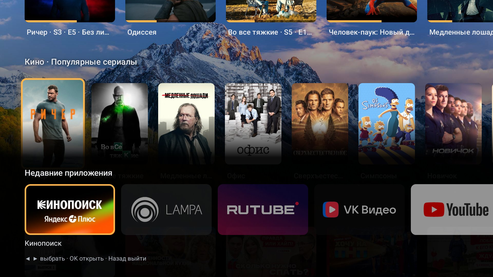
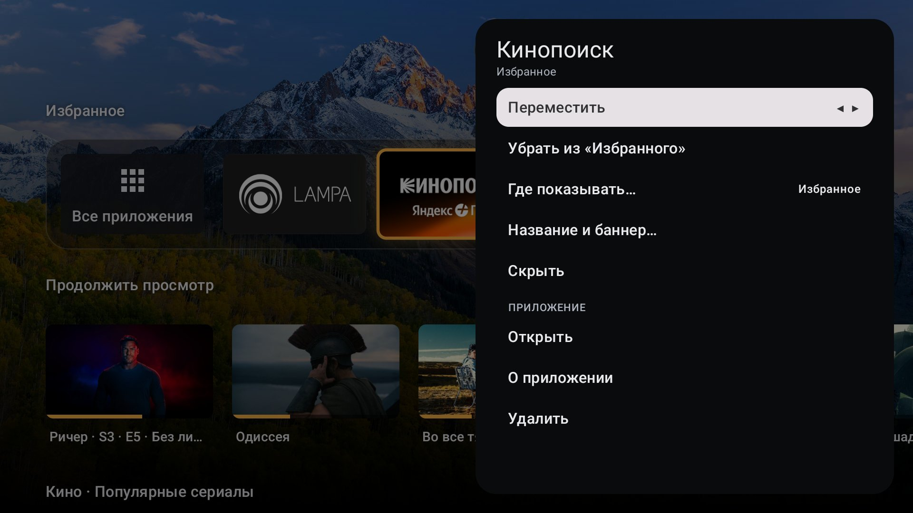

# Lumbina

A launcher for Android TV. Works without Google services. Made and tested on Hisense VIDAA
projectors with Chinese firmware.

It works, but it's not 1.0 yet.


## Why

On some firmware you can't just replace the stock launcher. Home is wired to the vendor's
launcher and the mic button opens the vendor's assistant. Lumbina takes both buttons back with an
accessibility service, and any other button of the remote you choose to give something to do.

## What it does

- Home opens Lumbina. Double press shows recent apps, long press opens a quick menu: all apps,
  recent apps, sleep timer, the phone remote, the device's settings, another home screen (the
  device's own launcher, or one you choose), Lumbina's settings. On Lumbina's own screens the Menu
  button opens that menu too.
- Remote buttons are yours to set: a press, a double press and a hold of a button can each open
  an app or one of Lumbina's screens, control the player, turn the screen off, or do nothing. A
  button can be Lumbina's only on its own screens and stay the app's everywhere else.
- Search from the home screen goes to the system's search or to YouTube, as you choose.
- Home screen with favorites, rows and folders, and a row of your apps ending in "See all": every
  app, with search and filters, on a screen of its own. Rows can be reordered, resized, hidden and
  put on a glass backing, with app names on the tiles, under them or none; apps renamed and hidden.
- A setup that walks through what a fresh install needs, a step at a time; any step can wait.
- "Continue watching" and the channels apps publish. If the firmware has no TV provider, Lumbina
  installs its own.
- Voice input from the remote's mic into any text field. Offline (Vosk, Russian and English),
  through OpenAI or Yandex SpeechKit with your own key, or by another app on the device that
  recognizes speech for apps (experimental: on Hisense, Android 13 or newer, with debugging
  Lumbina can reach).
- Voice search in other apps on Hisense, where the firmware gives them no microphone (Android 13
  or newer, with debugging Lumbina can reach).
- Voice commands: open or close an app, search, volume, playback, sleep timer. Where a name fits
  several apps, they are offered to choose from.
- Wallpapers: your own pictures and videos, photo of the day, Projectivy wallpaper plugins, or
  none: the theme's background.
- Clock, weather, notifications, now playing.
- Dark and light themes with a choice of accent.
- Screensaver, sleep timer, auto-sleep.
- Phone as a remote. Scan the QR code and a web page opens, nothing to install. The code can be
  shown on the screensaver, and a saved diagnostics report can be taken with the phone.
- Checks for a new version and installs it, when you ask.
- No ads, no telemetry, no account.

## Screenshots

The interface is in Russian here; it also comes in English.

| | |
|---|---|
|  |  |
|  |  |
|  |  |
|  |  |

The posters and stills in the rows are what the apps installed on the device publish ("continue
watching" and "Кино" come from a demo app with pictures from TMDB); they, like the apps on the
tiles, belong to their owners: see [NOTICE](NOTICE).

## Build

You need JDK 17 or newer and Android SDK 37. Open the folder in Android Studio and press Run.
Or from the command line:

```sh
./gradlew :app:assembleFossDebug
```

All checks. CI runs them too and builds a release:

```sh
./gradlew checkModuleGraph spotlessCheck detekt lint test testDebugUnitTest testFossDebugUnitTest
```

Install on a device over the network:

```sh
bash scripts/device/connect.sh 192.168.1.50
bash scripts/device/install.sh
bash scripts/device/enable-a11y.sh     # if the firmware hides the accessibility settings
```

There are PowerShell versions of the scripts next to them.

One thing about release APKs. They are built with a process name prefix that is set outside this
repository. Everything else in them comes from this source. On Hisense your own build may work
worse than a release.

## Code

Kotlin, Compose for TV, Hilt. The domain is plain Kotlin with ports, Android and vendor code sits
behind them. Device quirks live in `:vendor:*` modules, so a new device is a new module.
More in [docs/architecture.md](docs/architecture.md).

## Privacy

No account, no analytics, no server of ours. Settings and launch history stay on the device.
Lumbina talks to these services directly, so each of them sees your IP:

| Service | When | What it gets | How to turn it off |
|---|---|---|---|
| [ipwho.is](https://ipwho.is), [geojs.io](https://www.geojs.io) | Weather with automatic city | The request itself (city by IP) | Choose a city or hide the weather |
| [api.met.no](https://api.met.no), [open-meteo.com](https://open-meteo.com) | Weather is on screen, every 30 min | Coordinates of the city | Hide the weather |
| [geocoding-api.open-meteo.com](https://open-meteo.com) | You search for a city | What you typed | Don't search |
| [picsum.photos](https://picsum.photos), [bing.com](https://www.bing.com) | Screensaver or "Photo of the day" wallpaper | Screen size | Turn off online photos, pick another wallpaper |
| [alphacephei.com](https://alphacephei.com), [huggingface.co](https://huggingface.co) | You download a speech model | Which model | Don't download |
| [api.openai.com](https://openai.com), [stt.api.cloud.yandex.net](https://yandex.cloud/services/speechkit) | You chose cloud recognition | Audio of each phrase and your API key | Recognize on the device, it's the default |
| Another app on the device, and whatever it sends on | You chose another app to recognize | Audio of each phrase | Recognize on the device, it's the default |
| [api.github.com, github.com](https://github.com/Kasavy/lumbina/releases) | You check for a new version of Lumbina | The request itself; then the download | Don't check: nothing is checked by itself |
| Whatever hosts the apps name | An app publishes channels or "continue watching" | The request for the artwork the app points to | Hide the row or the channel |
| Wallpaper plugins | You chose a plugin as wallpaper | Whatever the plugin asks for | Pick another wallpaper |

Recognized phrases go to Lumbina's log on the device, with the names of the apps and windows you
open. The log leaves the device only if you save a diagnostics report yourself and send it to
someone: the report is a file with the log's tail, facts about the device and its firmware, and
lists of its system apps and of the apps that publish channels. While the phone remote is on, the
last report you saved can also be downloaded from the device by whoever has the remote's key.
The phone remote is plain HTTP on the local network, protected by the key in its QR code; if you
turn on showing the code on the screensaver, everyone in the room can read that key.

What every permission is used for: [SECURITY.md](SECURITY.md).

## License

GPL-3.0, see [LICENSE](LICENSE) and [NOTICE](NOTICE). Use it, change it, share it. If you
distribute a changed version, publish its source under the same license.

The name Lumbina and the icons are not part of the license. A fork needs its own name, icon and
application id, see [TRADEMARKS.md](TRADEMARKS.md).

Not affiliated with Hisense, Vidda, Google or anyone else.
